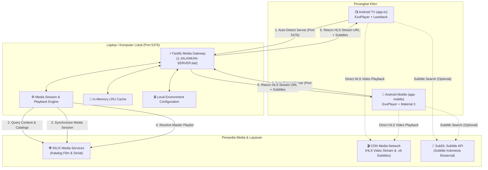

# 🎬 IDLIX Player: Android TV & Android Mobile

<p align="center">
  
</p>

<p align="center">
  <strong>Aplikasi Streaming Native Modern untuk Android TV & Android Mobile</strong><br>
  Didukung oleh Fastify Media Gateway, Sistem Auto-Update Hybrid, dan Integrasi Subtitle Multi-Bahasa.
</p>

<p align="center">
  <a href="https://github.com/claudiaaulerie/IDLIX-Player"></a>
  <a href="https://github.com/claudiaaulerie/IDLIX-Player/releases"></a>
  <a href="https://kotlinlang.org"></a>
  <a href="https://fastify.dev"></a>
  <a href="https://github.com/claudiaaulerie/IDLIX-Player/actions"></a>
</p>

---

### 🚀 Tautan Cepat (Quick Links)

| 📺 Android TV APK | 📱 Mobile HP APK | 💻 Web Dashboard | 🐧 Panduan Linux | 📜 Panduan TV |
| :---: | :---: | :---: | :---: | :---: |
| [**Download v1.0.7 TV**](APK_Installers/Android_TV/IDLIX-TV-Modified%20(Auto-Detect).apk) | [**Download v1.0.7 Mobile**](APK_Installers/Mobile_HP/IDLIX-Mobile-Modified%20(Auto-Detect).apk) | [**http://localhost:5376**](http://localhost:5376) | [**Buka Panduan Linux**](docs/PANDUAN_LINUX.md) | [**Panduan Pasang TV**](docs/PANDUAN_INSTALASI_TV.md) |

---

## 📑 Daftar Isi
- [💡 Tentang Proyek](#-tentang-proyek)
- [📦 Status Rilis & Download APK](#-status-rilis--download-apk)
- [🏗️ Arsitektur Sistem](#️-arsitektur-sistem)
- [🌟 Fitur-Fitur Utama](#-fitur-fitur-utama)
  - [🎬 Pemutaran Native HLS 1080p & Subtitle Bahasa Indonesia](#-pemutaran-native-hls-1080p--subtitle-bahasa-indonesia)
  - [🔄 Sistem Auto-Update Otomatis (LAN + GitHub)](#-sistem-auto-update-otomatis-lan--github)
  - [🔍 1-Click Auto-Detect Server](#-1-click-auto-detect-server)
  - [📺 Fitur Android TV Client (`app-tv`)](#-fitur-android-tv-client-app-tv)
  - [📱 Fitur Android Mobile Client (`app-mobile`)](#-fitur-android-mobile-client-app-mobile)
  - [💻 Backend API & Web Player Bawaan](#-backend-api--web-player-bawaan)
- [🚀 Panduan Penggunaan Cepat](#-panduan-penggunaan-cepat)
- [📁 Struktur Direktori](#-struktur-direktori)
- [🛠️ Panduan Build & Kompilasi](#️-panduan-build--kompilasi)
- [❓ FAQ & Troubleshooting](#-faq--troubleshooting)
- [🔒 Keamanan & Lisensi](#-keamanan--lisensi)

---

## 💡 Tentang Proyek

**IDLIX Player** adalah aplikasi streaming film dan serial TV *native* Android berkinerja tinggi yang dibangun untuk dua jenis layar utama:
1. **Android TV / Google TV**: Antarmuka 10-foot Leanback yang dioptimalkan untuk navigasi remote D-Pad, pemutaran video HLS hardware-accelerated (`MediaCodec`), dan billboard sinematik.
2. **Android Smartphone & Tablet**: Antarmuka responsif Material 3 dengan kontrol sentuh cerdas (*swipe gestures*, *double-tap seek*), mode pemutar ganda (*inline-to-fullscreen*), dan *Picture-in-Picture (PiP)*.

Kedua aplikasi didukung oleh **Backend Media Gateway & Proxy Service** berbasis Fastify TypeScript yang bertindak sebagai jembatan media lokal berkecepatan tinggi, mengelola katalog film dan serial, serta menyajikan stream *HLS master playlist* dan subtitle Bahasa Indonesia secara mulus ke ExoPlayer di aplikasi Android.

---

## 📦 Status Rilis & Download APK

Semua paket installer APK siap pasang telah tersedia langsung di direktori [`APK_Installers/`](APK_Installers/):

| Platform | Versi | File APK | Ukuran | Status |
| :--- | :---: | :--- | :---: | :---: |
| 📺 **Android TV / Google TV** | **v1.0.7** | [`IDLIX-TV-Modified (Auto-Detect).apk`](APK_Installers/Android_TV/IDLIX-TV-Modified%20(Auto-Detect).apk) | ~22.1 MB |  |
| 📱 **Android Mobile (HP/Tablet)** | **v1.0.7** | [`IDLIX-Mobile-Modified (Auto-Detect).apk`](APK_Installers/Mobile_HP/IDLIX-Mobile-Modified%20(Auto-Detect).apk) | ~23.2 MB |  |
| ⚡ **Backend API Server** | **v1.0.1** | [`Backend API/`](Backend%20API/) | - |  |

> 💡 **Unduh Langsung dari HP / TV**: Anda juga dapat mengunduh installer APK langsung melalui tautan raw GitHub pada file [`releases.ini`](releases.ini).

---

## 🏗️ Arsitektur Sistem

Berikut diagram alur kerja komunikasi antara aplikasi klien, gateway server lokal, dan penyedia konten:



---

## 🌟 Fitur-Fitur Utama

### 🎬 Pemutaran Native HLS 1080p & Subtitle Bahasa Indonesia
* **Resolusi Full HD 1080p Native**: Menghadirkan streaming HLS berkualitas tinggi langsung ke Media3 ExoPlayer di TV dan ponsel.
* **Manajemen Sesi Pemutaran Otomatis**: Gateway backend secara andal mengelola inisiasi sesi video dan meneruskan URL stream master playlist secara instan.
* **Subtitle Bahasa Indonesia Bawaan**: Trek subtitle resmi `.vtt` bahasa Indonesia terdeteksi dan terpasang otomatis pada pemutar video.
* **Dukungan Audio & Multi-Trek**: Kompatibel dengan berbagai format trek audio dan penyesuaian tampilan teks.

### 🔄 Sistem Auto-Update Otomatis (LAN + GitHub)
* **Pemberitahuan Otomatis**: Setiap kali ada file APK versi baru di repositori Anda, aplikasi TV dan Mobile akan memunculkan pop-up notifikasi: *"Update Tersedia: Pasang Sekarang"*.
* **Dual-Path Downloader**:
  1. **Jalur Cepat (LAN Wi-Fi)**: Jika server laptop menyala, APK diunduh langsung dari server lokal (`/api/update/apk/:platform`) dengan kecepatan penuh jaringan lokal.
  2. **Jalur Cloud (GitHub Raw)**: Jika di luar jangkauan server lokal, aplikasi otomatis mengunduh APK dari GitHub resmi Anda.
* **1-Click Version Bumping ([`2-UPDATE-VERSI-APK.bat`](2-UPDATE-VERSI-APK.bat))**:
  Cukup jalankan script ini di Windows untuk menaikkan versi, memperbarui [`releases.ini`](releases.ini), dan mem-push rilis baru ke GitHub sekaligus.

### 🔍 1-Click Auto-Detect Server
* Di menu **Settings (Pengaturan)** aplikasi Android TV maupun Mobile, cukup tekan tombol **"Auto-Detect Server"**.
* Aplikasi akan memindai subnet Wi-Fi lokal Anda secara paralel (`192.168.x.1..254` pada port `5376`) dan langsung menghubungkan aplikasi ke backend laptop Anda secara otomatis tanpa perlu mengetik alamat IP secara manual!

### 📺 Fitur Android TV Client (`app-tv`)
* **100% Native Leanback Architecture**: Bebas WebView. Menggunakan Media3 ExoPlayer dengan decoder hardware TV bawaan (`MediaCodec`) untuk playback tanpa stuttering.
* **D-Pad Remote Friendly**: Desain antarmuka 10-foot yang responsif terhadap navigasi remote TV fisik.
* **Token Query Preserving**: Menjamin token otorisasi CDN tetap utuh pada segment chunk video.
* **Subtitle Manager & SubDL**: Pemilihan subtitle resmi atau pencarian manual subtitle alternatif via SubDL langsung dari remote TV.

### 📱 Fitur Android Mobile Client (`app-mobile`)
* **Material 3 & Edge-to-Edge**: Tampilan modern tanpa benturan notch / kamera punch-hole.
* **Dual-Mode Player**: Tontonan inline 16:9 yang mulus di bagian atas saat membaca sinopsis, atau beralih ke Fullscreen Landscape dengan satu ketukan.
* **Kontrol Sentuh Intuitif**:
  * *Double-Tap Kiri/Kanan*: Mundur / Maju 10 detik.
  * *Vertical Drag Kiri*: Atur kecerahan layar.
  * *Vertical Drag Kanan*: Atur volume audio.
* **Picture-in-Picture (PiP)**: Otomatis masuk ke mode melayang (floating PiP) saat berpindah aplikasi.

### 💻 Backend API & Web Player Bawaan
* **Live Dashboard**: Menampilkan status server, daftar IP jaringan lokal, dan status gateway di `http://localhost:5376`.
* **Integrated Web Player**: Akses `http://localhost:5376/player` untuk menonton langsung dari browser laptop Anda.
* **Resilience & Anti-Crash**: Arsitektur server yang tangguh dengan penanganan error 24/7.

---

## 🚀 Panduan Penggunaan Cepat

Ikuti 3 langkah mudah berikut untuk mulai menonton:

### Langkah 1: Jalankan Server di Laptop / Komputer / VPS
Pilih salah satu metode sesuai sistem operasi Anda:

* **🪟 Windows**:
  1. Buka folder proyek di laptop Anda.
  2. Klik dua kali file [`1-JALANKAN-SERVER.bat`](1-JALANKAN-SERVER.bat).
* **🐧 Linux (Ubuntu, Debian, CentOS, Fedora, Arch, Raspberry Pi, VPS)**:
  1. Pasang dependensi otomatis: `chmod +x install-linux.sh run-server.sh && ./install-linux.sh`
  2. Jalankan server: `./run-server.sh`
* **🐳 Docker (Universal Semua OS)**:
  1. Jalankan langsung: `docker compose up -d`

Jendela server akan terbuka dan menampilkan status:
```
======================================================
       IDLIX BACKEND API BERHASIL AKTIF
======================================================
 > Akses Laptop (Local) : http://localhost:5376
 > Akses Android TV/HP  : http://192.168.1.163:5376
======================================================
```
*(Panduan lengkap Linux, Systemd Service 24/7, dan VPS tersedia di [docs/PANDUAN_LINUX.md](docs/PANDUAN_LINUX.md))*

### Langkah 2: Instal APK ke TV dan HP
* **Android TV**: Salin [`IDLIX-TV-Modified (Auto-Detect).apk`](APK_Installers/Android_TV/IDLIX-TV-Modified%20(Auto-Detect).apk) ke flashdisk lalu instal di TV via File Manager, atau gunakan aplikasi *Send Files to TV*.
* **HP Android**: Salin dan pasang [`IDLIX-Mobile-Modified (Auto-Detect).apk`](APK_Installers/Mobile_HP/IDLIX-Mobile-Modified%20(Auto-Detect).apk) langsung di smartphone Anda.

### Langkah 3: Hubungkan Aplikasi ke Server
1. Pastikan TV / HP terhubung ke **jaringan Wi-Fi yang sama** dengan laptop/server (atau gunakan IP/domain VPS jika di cloud).
2. Buka aplikasi IDLIX di TV atau HP Anda.
3. Masuk ke menu **Settings (Pengaturan)** ⚙️ -> Klik tombol **"Auto-Detect Server"**.
4. Status akan berubah menjadi **Connected** dan katalog film siap dinikmati!

---

## 📁 Struktur Direktori

```
IDLIX Player/
├── 1-JALANKAN-SERVER.bat                # Script peluncur server backend (1-klik di Windows)
├── 2-UPDATE-VERSI-APK.bat               # Script rilis versi baru & notifikasi auto-update
├── install-linux.sh                     # Script installer otomatis untuk semua distro Linux
├── run-server.sh                        # Script peluncur server backend untuk Linux & VPS
├── docker-compose.yml                   # Orkestrasinya Docker Container universal
├── releases.ini                         # Konfigurasi versi rilis dan tautan update
├── .env.example                         # Template konfigurasi variabel lingkungan
│
├── APK_Installers/                      # Paket installer APK siap pasang
│   ├── Android_TV/                      # Installer khusus Android TV / Google TV
│   │   ├── IDLIX-TV-Modified (Auto-Detect).apk
│   │   └── README.md
│   ├── Mobile_HP/                       # Installer khusus Smartphone & Tablet
│   │   ├── IDLIX-Mobile-Modified (Auto-Detect).apk
│   │   └── README.md
│   └── PANDUAN_INSTALL.txt              # Panduan instalasi cepat
│
├── Backend API/                         # Layanan media gateway backend (Fastify TypeScript)
│   ├── src/
│   │   ├── engine/                      # Media Engine & Playback Resolver
│   │   ├── routes/                      # REST Endpoints (/api/movies, /watch/..., /update/...)
│   │   ├── services/                    # Cache & Live Web Dashboard
│   │   └── server.ts                    # Entrypoint Server Fastify
│   ├── public/                          # Antarmuka Web Player bawaan
│   ├── .env.example                     # Template konfigurasi publik
│   ├── Dockerfile                       # Multi-stage container image (Chromium + Xvfb)
│   ├── docker-compose.yml
│   └── package.json
│
├── tools/
│   ├── idlix-backend.service            # Unit template systemd untuk auto-start di Linux VPS
│   └── dev-backend.bat                  # Peluncur mode dev
│
├── docs/
│   ├── PANDUAN_LINUX.md                 # Panduan komprehensif instalasi di berbagai distro Linux
│   └── PANDUAN_INSTALASI_TV.md          # Panduan pasang APK di Android TV
│
├── app-tv/                              # Modul aplikasi native Android TV (Jetpack Compose)
│   ├── src/main/java/com/idlix/tv/      # UI Leanback, NavDrawer, TV Player & Settings
│   └── build.gradle.kts
│
├── app-mobile/                          # Modul aplikasi native Android Mobile (Material 3)
│   ├── src/main/java/com/idlix/mobile/  # UI Material 3, Gestures, PiP, Dual-Mode Player
│   └── build.gradle.kts
│
├── core/
│   ├── data/                            # Shared Library: Retrofit API, Subnet Scanner, Database
│   └── player-ui/                       # Shared UI: Subtitle overlay & repositioner
│
├── .github/workflows/
│   └── build-apk.yml                    # CI/CD otomatis kompilasi APK cloud (JDK 21)
└── settings.gradle.kts
```

---

## 🛠️ Panduan Build & Kompilasi

### 1. Backend API (Linux & Windows)
* **Instalasi Otomatis Linux**:
  ```bash
  chmod +x install-linux.sh && ./install-linux.sh
  ./run-server.sh
  ```
* **Kompilasi Manual**:
  ```bash
  cd "Backend API"
  npm install
  npm run build
  npm start
  ```
* **Menggunakan Docker (Universal)**:
  ```bash
  docker compose up -d --build
  ```
*(Baca panduan lengkap konfigurasi Linux & VPS di [`docs/PANDUAN_LINUX.md`](docs/PANDUAN_LINUX.md))*

### 2. Kompilasi APK Android via Gradle
```bash
# Build Android TV APK
./gradlew :app-tv:assembleDebug

# Build Android Mobile APK
./gradlew :app-mobile:assembleDebug
```

### 3. Kompilasi Otomatis via GitHub Actions
Repositori ini telah dikonfigurasi dengan workflow CI/CD GitHub Actions (`.github/workflows/build-apk.yml`) berbasis **Ubuntu & JDK 21 Temurin**. Setiap kali ada perubahan kode yang di-push ke branch `main`, GitHub Actions akan otomatis mengompilasi APK TV dan Mobile terbaru yang dapat diunduh langsung pada tab **Actions** repositori Anda.

---

## ❓ FAQ & Troubleshooting

<details>
<summary><strong>Q: Video tidak berputar atau muncul pesan "Gagal mengambil master playlist HLS"?</strong></summary>
<p>

1. Pastikan server backend di laptop sedang menyala melalui script `1-JALANKAN-SERVER.bat`.
2. Pastikan file `.env` lokal di laptop sudah terisi dengan benar untuk menghubungkan layanan gateway backend.
3. Pastikan aplikasi TV atau HP sudah menggunakan rilis terbaru (v1.0.7) yang mendukung endpoint sesi pemutaran terbaru.
</p>
</details>

<details>
<summary><strong>Q: Tombol Auto-Detect Server tidak menemukan laptop?</strong></summary>
<p>

1. Pastikan laptop dan TV/HP terhubung ke Wi-Fi / Router yang sama.
2. Periksa apakah Windows Firewall memblokir port `5376`. Berikan izin (*Allow access*) untuk Node.js di Firewall.
3. Anda juga dapat memasukkan alamat IP laptop secara manual di menu Pengaturan (misal: `http://192.168.1.163:5376`).
</p>
</details>

<details>
<summary><strong>Q: Bisakah saya menonton film langsung di laptop tanpa HP atau TV?</strong></summary>
<p>
Bisa! Setelah menjalankan <code>1-JALANKAN-SERVER.bat</code>, buka browser laptop Anda dan masuk ke alamat <a href="http://localhost:5376/player">http://localhost:5376/player</a>.
</p>
</details>

---

## 🔒 Keamanan & Lisensi

* **Privasi Kredensial**: File konfigurasi lokal (`.env`, `local.properties`, keystore) sepenuhnya dilindungi dan diabaikan oleh [`.gitignore`](.gitignore).
* **Pembuat & Pengembang**: [claudiaaulerie](https://github.com/claudiaaulerie)
* **Repositori Resmi**: [https://github.com/claudiaaulerie/IDLIX-Player](https://github.com/claudiaaulerie/IDLIX-Player)
* **Pemberitahuan Lisensi**: Proyek ini dikembangkan secara independen untuk tujuan riset arsitektur aplikasi native multi-platform Android dan streaming media HLS. Seluruh konten media merupakan hak cipta dari masing-masing penyedia layanan.
